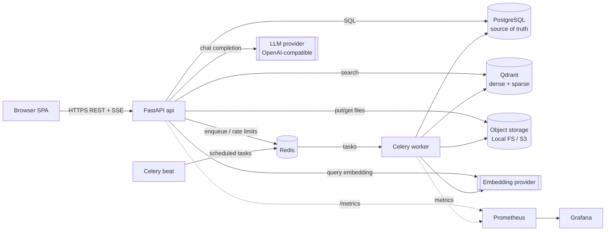
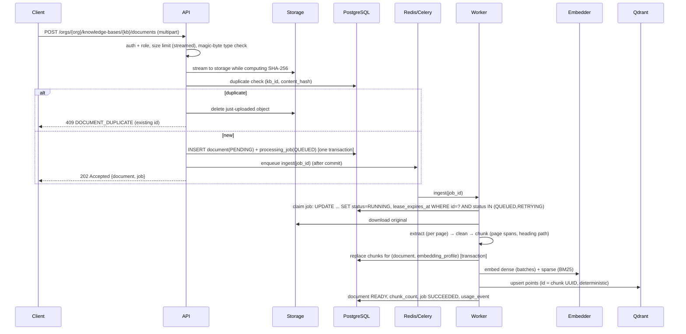

# Cortex — Architecture

> Status: **PROPOSAL — awaiting approval** (TASK-00.03). Nothing in this document is implemented yet.
> Related: [DATABASE_DESIGN.md](DATABASE_DESIGN.md) · [API_SPECIFICATION.md](API_SPECIFICATION.md) · [DECISIONS.md](DECISIONS.md) · [TECH_STACK.md](TECH_STACK.md)

## 1. Architectural style

Cortex is a **modular monolith** with **separately deployed background workers**:

| Process | Same codebase? | Role |
|---|---|---|
| `api` | yes (`backend/app`) | FastAPI HTTP server. Auth, CRUD, upload, retrieval + generation for chat. Never parses/embeds documents. |
| `worker` | yes | Celery worker. Extraction → cleaning → chunking → embedding → indexing; deletion cleanup. |
| `beat` | yes | Celery beat scheduler. Reconciler (stuck jobs, PG↔Qdrant consistency), retention jobs. Exactly one instance. |
| `frontend` | no (`frontend/`) | React SPA, served as static files (Nginx/CloudFront) in production. |

Why not microservices: one team, one data model, one deploy cadence. Splitting would add network hops, distributed auth and schema coupling without any scaling benefit at this size. The worker is split out because its *resource profile* differs (CPU/RAM-heavy, long-running), not because it is a different domain. See ADR-001.

## 2. System context



## 3. Repository layout (target)

```
D:\Projects\Cortex\
├── backend/
│   ├── app/
│   │   ├── main.py                 # app factory: create_app()
│   │   ├── api/
│   │   │   ├── deps.py             # shared FastAPI dependencies (db session, current user, org context)
│   │   │   └── v1/
│   │   │       ├── router.py
│   │   │       ├── auth.py  organizations.py  knowledge_bases.py
│   │   │       ├── documents.py  conversations.py  analytics.py  search.py  health.py
│   │   ├── core/                   # cross-cutting: security (jwt, hashing), errors, logging, pagination, rate_limit
│   │   ├── config/                 # pydantic-settings; per-environment validation
│   │   ├── database/               # engine, session factory, Base, naming conventions, unit of work
│   │   ├── models/                 # SQLAlchemy ORM models (one module per aggregate)
│   │   ├── schemas/                # Pydantic request/response models (API contract)
│   │   ├── repositories/           # all SQL lives here; every query is tenant-scoped
│   │   ├── services/               # business logic; transaction boundaries; authorization decisions
│   │   ├── middleware/             # request id, access log, security headers, metrics
│   │   ├── dependencies/           # provider factories (storage, embedder, llm, reranker, qdrant)
│   │   ├── workers/                # celery_app.py, tasks/ (ingest, delete, reconcile), task base with retry policy
│   │   ├── storage/                # StorageBackend protocol, local.py, s3.py
│   │   ├── uploads/                # streaming multipart intake, type detection from bytes, filenames
│   │   ├── rag/
│   │   │   ├── ingestion/          # parsers (pdf, docx, txt, md), cleaner, pipeline orchestration
│   │   │   ├── chunking/           # structure-aware token splitter
│   │   │   ├── embeddings/         # EmbeddingProvider protocol, fastembed, openai_compat, fake; sparse encoder
│   │   │   ├── retrieval/          # qdrant index wrapper, dense, sparse, hybrid fusion, hydration
│   │   │   ├── reranking/          # Reranker protocol, cross-encoder, no-op
│   │   │   ├── generation/         # context builder, prompts (versioned), LLMProvider, answer generator, citation mapper
│   │   │   └── evaluation/         # datasets, metrics (recall@k, MRR), runners, reports
│   │   └── utils/
│   ├── migrations/                 # Alembic
│   ├── tests/
│   │   ├── unit/  integration/  tenant_isolation/  workers/  rag/  eval/
│   │   └── fixtures/documents/     # small PDFs/DOCX/MD used by tests
│   ├── pyproject.toml  uv.lock  alembic.ini  Dockerfile
├── frontend/
│   ├── src/
│   │   ├── api/                    # generated OpenAPI types + thin service modules (no fetch in components)
│   │   ├── stores/                 # Zustand: auth, org, ui
│   │   ├── components/ui/          # shadcn primitives
│   │   ├── components/             # shared app components
│   │   ├── features/               # auth, dashboard, knowledge-bases, documents, chat, analytics, settings
│   │   ├── routes/  lib/  hooks/
│   ├── package.json  vite.config.ts  Dockerfile
├── infra/
│   ├── compose/                    # docker-compose.yml (dev), compose.monitoring.yml, compose.test.yml
│   ├── monitoring/                 # prometheus.yml, grafana provisioning + dashboards
│   └── deploy/                     # production compose / Caddyfile or IaC (decided in Phase 16)
├── scripts/                        # PowerShell + Python helper scripts (seed, eval, reset-dev)
├── eval/                           # evaluation corpus manifest + question set (public-domain sources)
├── docs/{architecture,database,api,development,deployment,testing,decisions}/
├── .github/workflows/              # ci.yml, deploy.yml
└── PROJECT_PLAN.md  TASK_TRACKER.md  ARCHITECTURE.md  ... (root planning docs)
```

The `app/` package layout follows the requested module list, placed under `backend/` so the frontend, infra and docs sit beside it in one repo.

## 4. Layering rules

```
api (routes)  →  services  →  repositories  →  database
                    │
                    └──→  rag/*, storage/*, workers (enqueue)  via injected providers
```

* **Routes**: parse/validate input (Pydantic), resolve dependencies (current user, org context), call one service method, map result to a response schema. No SQL, no business rules.
* **Services**: business rules, authorization decisions, transaction boundaries (commit/rollback), orchestration of providers. Services do not know about HTTP (they raise domain exceptions, not `HTTPException`).
* **Repositories**: the only place SQLAlchemy queries are written. Every repository method that reads tenant data takes `organization_id` as a required argument.
* **Providers** (storage, embedder, LLM, reranker, vector index) are defined as `typing.Protocol`s and injected — this is what makes the RAG engine testable without network access (fake providers in tests).
* **Exception mapping**: domain exceptions (`NotFound`, `Conflict`, `PermissionDenied`, `ValidationFailed`, `RateLimited`, `UpstreamUnavailable`) are mapped to HTTP responses in one place (`core/errors.py`).

## 5. Async model

* API: async FastAPI + SQLAlchemy 2.0 async with **psycopg 3** (one driver supports sync and async).
* Workers: Celery tasks are sync functions that call `asyncio.run(handler(...))`, so **repositories and services are written once (async)** and reused by workers. Each worker process creates its own engine on `worker_process_init` (never share connections across forks). See ADR-004.
* CPU-bound work in the API (query embedding with a local model, cross-encoder reranking) runs in a thread pool (`anyio.to_thread`) so it does not block the event loop. If it becomes a bottleneck, the documented escape hatch is to move models behind a separate inference process — not done pre-emptively.

## 6. Multi-tenancy & security model (summary)

Full document: [docs/architecture/security-model.md](docs/architecture/security-model.md) (threat model, token lifecycle, tenancy, RBAC, known gaps).

* **Tenant = organization.** Every tenant-owned row carries `organization_id` (denormalized onto documents, chunks, jobs, conversations, usage events) so every query and every vector search can filter on it directly.
* **Org context is never trusted from the client.** Routes are shaped `/api/v1/orgs/{org_id}/...`; the `org_id` in the path is only a *claim*. The `OrgContext` dependency loads the caller's membership row for `(org_id, current_user.id)`; no membership → **404** (not 403, to avoid confirming existence). The resulting `OrgContext(org_id, user_id, role)` is the only source of `organization_id` passed to services.
* **Every child resource is looked up with `(organization_id, id)`**, never `id` alone. A document id from org A used under org B's path returns 404.
* **Roles**: `OWNER > ADMIN > MEMBER`, enforced by `require_role(min_role)` dependency + service-level checks. Matrix in [API_SPECIFICATION.md](API_SPECIFICATION.md#roles).
* **Authorization before retrieval**: the retrieval service first resolves the KB ids the caller may search from PostgreSQL, and then passes them as a **mandatory Qdrant filter** (`organization_id = X AND knowledge_base_id IN [...]`). The vector index wrapper refuses to execute a search without a tenant filter (defence in depth, unit-tested).
* **DB-level integrity**: composite foreign keys ensure a document's `organization_id` equals its knowledge base's `organization_id` (see DATABASE_DESIGN §4), so a bug cannot create a cross-tenant child row.
* **Tenant isolation test suite** (TASK-03.08) grows every phase: every API route must be classified, and the owner, admin and member of org B call every org-A endpoint → 404 identical to an unknown org, and the database is unchanged.

## 7. Authentication

* Passwords: Argon2id (`pwdlib[argon2]`).
* **Access token**: JWT (HS256, 15 min), claims `sub, iat, exp, jti, typ=access, iss, aud` (all required, algorithm pinned). Sent as `Authorization: Bearer`. Held **in memory** by the SPA.
* **Refresh token**: opaque 256-bit random string, stored **hashed (SHA-256)** in `refresh_tokens`, 14-day expiry, **rotated on every use**; reuse of a rotated token revokes the whole token family (theft detection). Delivered to browsers as an `HttpOnly; Secure; SameSite=Strict; Path=/api/v1/auth` cookie. See ADR-006.
* Logout revokes the presented refresh token's family. Access tokens are short-lived and not individually revoked (documented trade-off).

## 8. Document ingestion pipeline



**Reliability properties**

| Concern | Mechanism |
|---|---|
| Large files never processed in request | API only stores + enqueues; returns 202. |
| Duplicate work / double delivery | Job claim is a conditional `UPDATE ... RETURNING` (only one worker wins). `acks_late=True` + idempotent steps make redelivery safe. |
| Duplicate vectors | Chunk UUIDs are deterministic: `uuid5(document_id, f"{embedding_profile}:{chunk_index}")`, used as Qdrant point ids → re-runs overwrite. Stale points from a previous run with more chunks are deleted by filter `document_id = X AND chunk_index >= new_count`. |
| Enqueue lost after commit (Redis down) | Job stays `QUEUED`; beat reconciler re-enqueues jobs `QUEUED` older than N minutes. |
| Worker crash mid-job | Lease (`lease_expires_at`); reconciler returns expired `RUNNING` jobs to `RETRYING` until `max_attempts`, then `FAILED`. |
| Transient vs permanent errors | `TransientError` (network, 5xx, timeouts) → Celery retry with exponential backoff + jitter. `PermanentError` (corrupt/encrypted file, unsupported content) → `FAILED` immediately with `error_code`. |
| PG ↔ Qdrant drift | No distributed transactions. PostgreSQL is the source of truth; Qdrant is a derived index. Reconciler compares per-document chunk counts with Qdrant `count(filter)` and re-indexes or purges orphans. |
| Deletion | `DELETE` sets document `DELETING` (hidden from all reads immediately), enqueues cleanup: delete Qdrant points by filter → delete storage object → delete PG rows. Every step idempotent; reconciler retries stuck `DELETING` docs. |
| Reprocessing | New `processing_job` (partial unique index allows only one active job per document). Same idempotent path. |

## 9. Retrieval & generation (RAG engine)

```mermaid
flowchart TD
    Q[User question + conversation] --> RW[Condense follow-up question<br/>(optional LLM call)]
    RW --> AZ[Resolve searchable KB ids<br/>from PostgreSQL (authorization)]
    AZ --> D[Dense search<br/>top_k_dense]
    AZ --> SP[Sparse BM25 search<br/>top_k_sparse]
    D --> F[Weighted RRF fusion<br/>w_dense, w_sparse, k=60]
    SP --> F
    F --> H[Hydrate from PostgreSQL<br/>text, doc title, pages; drop DELETING docs]
    H --> RR[Cross-encoder rerank<br/>rerank_top_n → final_k]
    RR --> CB[Context builder<br/>token budget, numbered sources S1..Sn,<br/>untrusted-content delimiters]
    CB --> G[LLM generation<br/>grounding + citation rules]
    G --> CM[Citation mapper<br/>validate S# markers → chunk/doc/page]
    CM --> OUT[Answer + citations + trace<br/>persist message, usage, latency]
```

* **Dense**: configurable `EmbeddingProvider`. Default dev profile: local `BAAI/bge-small-en-v1.5` (384-d) via FastEmbed (ONNX, CPU, no API cost). Production option: any OpenAI-compatible embeddings endpoint.
* **Sparse**: BM25 via FastEmbed `Qdrant/bm25` term weights + Qdrant sparse vectors with `modifier=idf` (IDF computed by Qdrant over the collection).
* **Fusion**: implemented in application code as **weighted Reciprocal Rank Fusion** so the weights are configurable and the algorithm is explainable; Qdrant's server-side RRF is benchmarked against it in Phase 14.
* **Reranking**: cross-encoder (`Xenova/ms-marco-MiniLM-L-6-v2` via FastEmbed, ONNX) behind a `Reranker` protocol; `NoOpReranker` for ablations.
* **Embedding versioning**: an *embedding profile* = `(provider, model, dimensions, version)` → its own Qdrant collection, e.g. `cortex_chunks__bge-small-en-v1.5__384__v1`. A knowledge base is pinned to one profile. Changing a model = create new collection, reindex in the background, flip the KB's profile when complete, drop old points afterwards. Vectors from different profiles are never mixed. See ADR-008.
* **Collection strategy**: one collection per embedding profile shared by all tenants, with `organization_id` as a tenant-indexed payload field (`is_tenant=true`) plus `knowledge_base_id` / `document_id` payload indexes. Collection-per-tenant does not scale in Qdrant and is explicitly discouraged by its docs. See ADR-007.
* **Grounding & safety**: system prompt requires answering only from numbered sources, citing `[S#]`, and replying with a fixed "not found in the provided documents" message otherwise. Document text is placed inside clearly delimited data blocks and the prompt states that instructions inside sources must be ignored. The citation mapper **discards any citation that does not refer to a source actually supplied** (no fabricated citations reach the client) and flags answers with zero valid citations.

## 10. Configuration & environments

* `pydantic-settings` reads environment variables (`CORTEX_` prefix); `.env` only in development, never committed; `.env.example` documents every variable.
* `CORTEX_ENV ∈ {development, test, staging, production}`. On startup in `staging`/`production`, validation **refuses to boot** with default/weak secrets, `DEBUG=true`, wildcard CORS, or the local storage backend.
* Secrets in production come from AWS SSM Parameter Store / Secrets Manager injected as env vars (decided in Phase 16).

## 11. Observability

* **Logs**: `structlog` JSON to stdout; every line carries `request_id`, `org_id`, `user_id` (ids only), and task id in workers. A redaction processor masks keys like `password`, `token`, `authorization`, `api_key`, `secret`; document text is never logged (only lengths/hashes).
* **Metrics**: `prometheus-client` — HTTP latency/status histograms, retrieval stage latencies, LLM latency and tokens, Celery task durations/outcomes, queue depth. Grafana dashboards provisioned from files (`infra/monitoring`). Optional compose profile `monitoring`.
* **Business analytics**: `usage_events` (tokens, cost estimate, latency) and per-message retrieval/generation latency columns in PostgreSQL power the analytics API.

## 12. Deployment (proposal — finalized and cost-approved in Phase 16)

Two options will be costed for approval; nothing is deployed without approval.

| | **A. Lean (recommended for portfolio)** | **B. Reference (scalable)** |
|---|---|---|
| Compute | 1× EC2 (e.g. t4g.medium/large) running Docker Compose: api, worker, beat, Redis, Qdrant (EBS volume), Caddy (auto-HTTPS) | ECS Fargate services (api, worker, beat) behind ALB |
| PostgreSQL | RDS PostgreSQL (db.t4g.micro) | RDS PostgreSQL Multi-AZ |
| Redis | container on the EC2 host | ElastiCache |
| Qdrant | container on EC2 + nightly snapshots to S3 | Qdrant Cloud or EC2 cluster |
| Files | S3 (private, SSE, versioning) | S3 |
| Frontend | S3 + CloudFront | S3 + CloudFront |
| Rough cost | low tens of USD / month | low hundreds of USD / month |

Exact figures will be produced with the AWS pricing calculator in TASK-16.01 before any approval request.

## 13. Key quality attributes

| Attribute | How it is achieved / measured |
|---|---|
| Tenant isolation | Path-claim + membership verification, org-scoped repositories, composite FKs, mandatory vector filters, isolation test suite |
| Reliability | Idempotent jobs, leases, reconciler, retries with backoff, deterministic point ids |
| Answer quality | Hybrid + rerank, evaluation harness (Recall@5, MRR, citation correctness, faithfulness), ablations recorded in `docs/testing/` |
| Performance | Measured, never assumed: p50/p95 API latency, ingestion throughput, retrieval/generation stage latency, load tests |
| Operability | Health/readiness endpoints, structured logs, metrics, runbooks in `docs/deployment/` |
