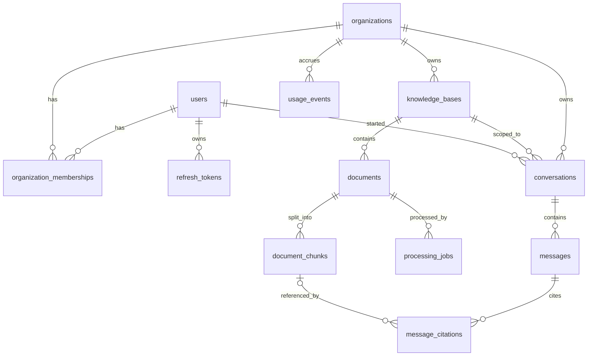

# Cortex — Database Design

> Status: **PROPOSAL — awaiting approval** (TASK-00.04). PostgreSQL 17 is the source of truth; Qdrant is a derived index.

## 1. Conventions

* Primary keys: `UUID` (generated in the application with `uuid.uuid7()`-style time-ordered ids where available, otherwise `uuid4`; time-ordered ids keep B-tree inserts local). Qdrant point ids reuse `document_chunks.id`.
* Timestamps: `created_at`, `updated_at` as `timestamptz` (UTC), set by DB defaults (`now()`) and an ORM `onupdate`.
* Enums: PostgreSQL native enums are painful to migrate; we use `varchar` + `CHECK` constraints, mirrored by Python `StrEnum`s.
* Constraint naming convention set on `MetaData` (`pk_%(table_name)s`, `fk_%(table_name)s_%(column_0_name)s_%(referred_table_name)s`, `uq_…`, `ix_…`, `ck_…`) so Alembic autogenerate produces stable names.
* Every tenant-owned table has `organization_id` (denormalized where needed) and an index whose **leading column is `organization_id`** for list queries.
* Pagination: keyset (cursor) on `(created_at DESC, id DESC)`; cursors are opaque base64 JSON. See API spec.
* Soft deletion is used only where a delete is asynchronous (`documents.status = 'DELETING'`) or must hide data instantly (`knowledge_bases.deleted_at`). Everything else is hard-deleted with `ON DELETE CASCADE` from its owner.

## 2. Entity-relationship diagram

## 3. Tables

### users
| Column | Type | Notes |
|---|---|---|
| id | uuid PK | |
| email | varchar(320) NOT NULL | stored as entered; uniqueness on `lower(email)` |
| password_hash | varchar(255) NOT NULL | Argon2id encoded hash |
| full_name | varchar(200) NOT NULL | |
| is_active | boolean NOT NULL default true | inactive users cannot log in |
| last_login_at | timestamptz NULL | |
| created_at / updated_at | timestamptz | |

Indexes: `uq_users_email_lower UNIQUE (lower(email))`. (Implementation note: the index must be built from the column, `func.lower(User.email)`. `func.lower("email")` lower-cases the string literal `'email'`, a constant that would allow only one user. The test `test_different_emails_can_both_register` guards this.)

### organizations
| Column | Type | Notes |
|---|---|---|
| id | uuid PK | |
| name | varchar(200) NOT NULL | |
| slug | varchar(80) NOT NULL UNIQUE | URL-friendly, generated |
| created_by_user_id | uuid FK users ON DELETE SET NULL | |
| created_at / updated_at | timestamptz | |

### organization_memberships
| Column | Type | Notes |
|---|---|---|
| id | uuid PK | |
| organization_id | uuid FK organizations ON DELETE CASCADE | |
| user_id | uuid FK users ON DELETE CASCADE | |
| role | varchar(16) NOT NULL CHECK IN ('OWNER','ADMIN','MEMBER') | |
| created_at / updated_at | timestamptz | |

Indexes: `UNIQUE (organization_id, user_id)` (also serves the membership lookup on every request), `ix (user_id)` for "my organizations". Invariant "at least one OWNER per org" is enforced in the service layer inside a transaction that locks the org's membership rows (`SELECT … FOR UPDATE`).

### refresh_tokens
| Column | Type | Notes |
|---|---|---|
| id | uuid PK | |
| user_id | uuid FK users ON DELETE CASCADE | |
| family_id | uuid NOT NULL | all rotations of one login share a family |
| token_hash | char(64) NOT NULL UNIQUE | SHA-256 hex of the opaque token; raw token never stored |
| expires_at | timestamptz NOT NULL | |
| revoked_at | timestamptz NULL | |
| replaced_by_id | uuid NULL FK refresh_tokens ON DELETE SET NULL | set on rotation; reuse of a replaced token ⇒ revoke family |
| created_at / updated_at | timestamptz | `updated_at` from the shared TimestampMixin; useful for revocation audits (implemented in TASK-02.03) |
| user_agent | varchar(300) NULL | for "active sessions" display |

Indexes: `ix (user_id)`, `ix (family_id)`. Expired rows purged by a beat task.

### knowledge_bases
| Column | Type | Notes |
|---|---|---|
| id | uuid PK | |
| organization_id | uuid FK organizations ON DELETE CASCADE | |
| name | varchar(200) NOT NULL | |
| description | text NULL | |
| embedding_profile | varchar(120) NOT NULL | e.g. `bge-small-en-v1.5__384__v1`; fixed per KB, changed only via reindex |
| chunk_size_tokens | int NOT NULL default 512 CHECK 64..2048 | |
| chunk_overlap_tokens | int NOT NULL default 64 CHECK ≥0 and < chunk_size | |
| created_by_user_id | uuid FK users ON DELETE SET NULL | |
| deleted_at | timestamptz NULL | soft delete; cleanup task purges docs then row |
| created_at / updated_at | timestamptz | |

Indexes: `UNIQUE (id, organization_id)` (target of composite FKs), `UNIQUE (organization_id, lower(name)) WHERE deleted_at IS NULL`, `ix (organization_id, created_at DESC)`.

### documents
| Column | Type | Notes |
|---|---|---|
| id | uuid PK | |
| organization_id | uuid NOT NULL | denormalized tenant key |
| knowledge_base_id | uuid NOT NULL | |
| uploaded_by_user_id | uuid FK users ON DELETE SET NULL | |
| filename | varchar(255) NOT NULL | sanitized original name (display only; never used as a path) |
| mime_type | varchar(100) NOT NULL | detected from content, not trusted from client |
| file_size_bytes | bigint NOT NULL | |
| content_hash | char(64) NOT NULL | SHA-256 of original bytes |
| storage_key | varchar(500) NOT NULL | `orgs/{org_id}/kbs/{kb_id}/docs/{doc_id}/original` |
| status | varchar(16) NOT NULL CHECK IN ('PENDING','PROCESSING','READY','FAILED','DELETING') | |
| page_count | int NULL | |
| chunk_count | int NOT NULL default 0 | |
| embedding_profile | varchar(120) NULL | profile its current vectors were built with |
| error_code | varchar(64) NULL | e.g. `PDF_ENCRYPTED`, `EXTRACTION_EMPTY` |
| error_message | varchar(1000) NULL | safe, user-facing |
| processed_at | timestamptz NULL | |
| created_at / updated_at | timestamptz | |

Constraints & indexes:
* `FK (knowledge_base_id, organization_id) → knowledge_bases (id, organization_id) ON DELETE CASCADE` — **guarantees a document cannot belong to a KB of another org**.
* `UNIQUE (knowledge_base_id, content_hash) WHERE status <> 'DELETING'` — duplicate scope is the knowledge base (the same file may legitimately live in two KBs).
* `ix (knowledge_base_id, created_at DESC)`, `ix (organization_id, status)`.

### document_chunks
| Column | Type | Notes |
|---|---|---|
| id | uuid PK | deterministic `uuid5(document_id, "{profile}:{chunk_index}")`; = Qdrant point id |
| organization_id | uuid NOT NULL | |
| knowledge_base_id | uuid NOT NULL | |
| document_id | uuid FK documents ON DELETE CASCADE | |
| embedding_profile | varchar(120) NOT NULL | |
| chunk_index | int NOT NULL | 0-based order in document |
| text | text NOT NULL | cleaned chunk text (source for context + citations) |
| token_count | int NOT NULL | |
| char_start / char_end | int NOT NULL | offsets into the cleaned document text |
| page_start / page_end | int NULL | 1-based; NULL for formats without pages (DOCX/TXT/MD) |
| section_path | varchar(1000) NULL | heading breadcrumb, e.g. `Chapter 2 > Pricing` |
| content_hash | char(64) NOT NULL | SHA-256 of text; enables skip-unchanged re-embedding |
| indexed_at | timestamptz NULL | set after Qdrant upsert succeeds |
| created_at | timestamptz | |

Indexes: `UNIQUE (document_id, embedding_profile, chunk_index)`, `ix (organization_id, knowledge_base_id)`. Hydration after vector search is `WHERE organization_id = :org AND id = ANY(:ids)` (PK lookup + tenant re-check).

### processing_jobs
| Column | Type | Notes |
|---|---|---|
| id | uuid PK | |
| organization_id | uuid NOT NULL | |
| document_id | uuid FK documents ON DELETE CASCADE | |
| job_type | varchar(16) CHECK IN ('INGEST','REINDEX','DELETE') | |
| status | varchar(16) CHECK IN ('QUEUED','RUNNING','RETRYING','SUCCEEDED','FAILED','CANCELLED') | |
| stage | varchar(16) NULL | `EXTRACTING`,`CHUNKING`,`EMBEDDING`,`INDEXING` — drives UI progress |
| attempts | int NOT NULL default 0 | |
| max_attempts | int NOT NULL default 5 | |
| celery_task_id | varchar(64) NULL | |
| lease_expires_at | timestamptz NULL | crash detection |
| started_at / finished_at | timestamptz NULL | |
| error_code / error_message | varchar NULL | last error |
| metrics | jsonb NULL | per-stage durations, pages, chunks, tokens |
| created_at / updated_at | timestamptz | |

Indexes: `UNIQUE (document_id) WHERE status IN ('QUEUED','RUNNING','RETRYING')` (**at most one active job per document**), `ix (status, lease_expires_at)` for the reconciler, `ix (document_id, created_at DESC)`.

### conversations
| Column | Type | Notes |
|---|---|---|
| id | uuid PK | |
| organization_id | uuid NOT NULL | |
| knowledge_base_id | uuid NOT NULL | composite FK `(knowledge_base_id, organization_id)` ON DELETE CASCADE |
| user_id | uuid FK users ON DELETE CASCADE | conversations are private to their creator |
| title | varchar(200) NOT NULL | first question, truncated; editable |
| created_at / updated_at | timestamptz | `updated_at` bumped on each message |

Indexes: `ix (organization_id, user_id, updated_at DESC)`.

### messages
| Column | Type | Notes |
|---|---|---|
| id | uuid PK | |
| conversation_id | uuid FK conversations ON DELETE CASCADE | |
| role | varchar(16) CHECK IN ('USER','ASSISTANT') | |
| content | text NOT NULL | |
| status | varchar(16) CHECK IN ('COMPLETE','FAILED') default 'COMPLETE' | |
| standalone_query | text NULL | condensed question actually used for retrieval |
| model | varchar(120) NULL | |
| prompt_version | varchar(32) NULL | |
| prompt_tokens / completion_tokens | int NULL | |
| retrieval_latency_ms / rerank_latency_ms / generation_latency_ms / total_latency_ms | int NULL | aggregated by analytics |
| retrieval_trace | jsonb NULL | candidate ids + scores per stage (debug/eval; no document text) |
| created_at | timestamptz | |

Indexes: `ix (conversation_id, created_at)`.

### message_citations
| Column | Type | Notes |
|---|---|---|
| id | uuid PK | |
| message_id | uuid FK messages ON DELETE CASCADE | |
| marker | int NOT NULL | the `n` in `[S n]` |
| chunk_id | uuid NULL FK document_chunks ON DELETE SET NULL | NULL once the document is deleted |
| document_id | uuid NULL FK documents ON DELETE SET NULL | |
| document_filename | varchar(255) NOT NULL | snapshot, so history stays readable after deletion |
| page_start / page_end | int NULL | |
| snippet | varchar(1000) NOT NULL | short excerpt shown in UI |
| relevance_score | real NULL | reranker score |

Indexes: `ix (message_id)`, `UNIQUE (message_id, marker)`.

### usage_events
| Column | Type | Notes |
|---|---|---|
| id | uuid PK | |
| organization_id | uuid FK organizations ON DELETE CASCADE | |
| user_id | uuid NULL FK users ON DELETE SET NULL | |
| event_type | varchar(32) CHECK IN ('DOC_EMBEDDING','QUERY_EMBEDDING','LLM_COMPLETION','QUERY_REWRITE','RERANK') | |
| provider / model | varchar | |
| input_tokens / output_tokens | int NOT NULL default 0 | |
| cost_usd | numeric(12,6) NOT NULL default 0 | estimate from configured price table (0 for local models) |
| latency_ms | int NULL | |
| document_id / message_id | uuid NULL | no FK (analytics must survive deletes) |
| created_at | timestamptz | |

Indexes: `ix (organization_id, created_at)`, `ix (organization_id, event_type, created_at)`. Growth note: if this becomes large, monthly range partitioning on `created_at` is the planned path (not done in MVP).

## 4. Integrity rules worth calling out

1. **Composite tenant FKs**: `documents`, `conversations` reference `knowledge_bases (id, organization_id)`. Chunks and jobs inherit `organization_id` from their document and are written only by the worker, which copies it from the document row.
2. **One active job per document** via partial unique index — the database, not application logic, prevents concurrent processing.
3. **No duplicate active documents per KB** via partial unique index — race-safe even if two uploads of the same file arrive concurrently (the loser gets a constraint violation mapped to 409).
4. **Deterministic chunk ids** make chunk insertion and Qdrant upserts idempotent.

## 5. Transactions

* One `AsyncSession` per request; the **service** decides when to commit. Repositories never commit.
* Enqueuing Celery tasks happens **after** a successful commit (`after_commit` hook / explicit post-commit call), so a worker never sees a job row that does not exist yet. Lost enqueues are recovered by the reconciler.
* Worker stages that touch PG run in short transactions; long operations (embedding, network calls) never hold a transaction open.

## 6. Migrations

* Alembic with async `env.py`, autogenerate + manual review of every migration.
* Each migration is tested by CI: `upgrade head` on an empty DB, then `downgrade base`, then `upgrade head` again.
* Data migrations are separate revisions from schema migrations.

## 7. Expected hot queries (to verify with `EXPLAIN ANALYZE` in TASK-14.05)

| Query | Index used |
|---|---|
| Membership check on every request | `uq_organization_memberships (organization_id, user_id)` |
| List KB documents (paginated) | `ix_documents (knowledge_base_id, created_at DESC)` |
| Hydrate retrieved chunks | `pk_document_chunks` + org filter |
| Reconciler stale jobs | `ix_processing_jobs (status, lease_expires_at)` |
| Conversation list | `ix_conversations (organization_id, user_id, updated_at DESC)` |
| Usage by day | `ix_usage_events (organization_id, created_at)` |
