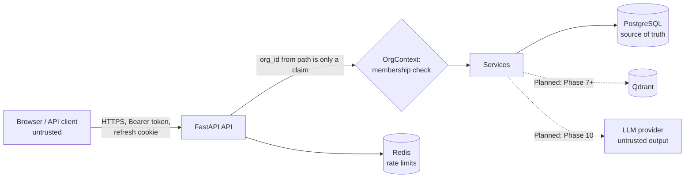
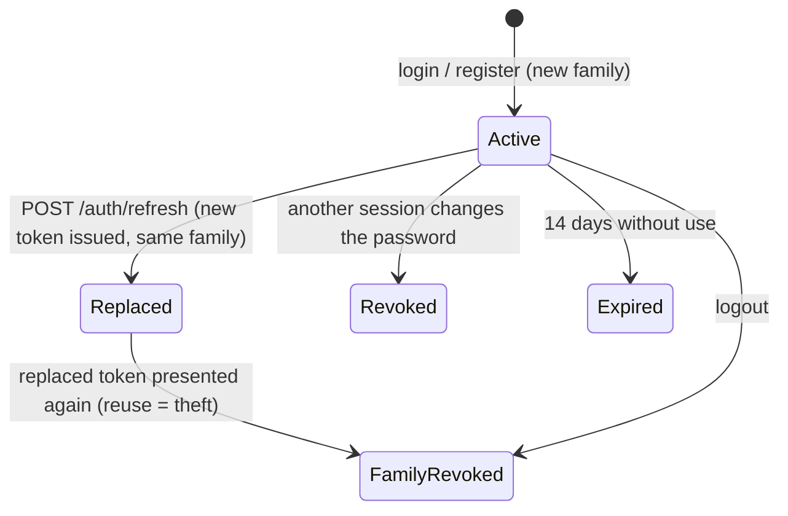

# Cortex security model

> Status: as implemented at the end of Phase 3 (TASK-03.09, 2026-11-27). Every statement below
> describes code that exists and is tested, unless it is marked **Planned**. When the code changes,
> this document changes in the same commit. Paths are relative to the repository root.

## 1. What we protect

| Asset | Why it matters | Where it lives |
|---|---|---|
| Tenant documents, chunks, conversations | The product's whole value; organizations must never see each other's data | PostgreSQL, Qdrant (from Phase 7), object storage (from Phase 4) |
| Account credentials | Account takeover | `users.password_hash` (Argon2id) |
| Sessions | Long-lived access without a password | `refresh_tokens.token_hash` (SHA-256), browser cookie |
| Signing secret (`CORTEX_AUTH__JWT_SECRET`) | Forging any user's access token | Environment / secret store only |
| Personal data (emails, names, IPs) | Privacy, enumeration | PostgreSQL; never in logs or Redis keys |

## 2. Trust boundaries

1. **Client → API.** Everything in a request is attacker-controlled: path, query, headers, body, cookies. Identity comes only from a verified token; tenant only from a verified membership.
2. **API → data stores.** Stores are trusted but never the only line of defence: tenant rules are enforced in the service layer *and* by database constraints.
3. **Planned:** uploaded files and LLM output are untrusted content (TASK-15.04).

## 3. Threats and controls (STRIDE)

| Threat | Example | Controls | Evidence |
|---|---|---|---|
| **Spoofing** | Guess or steal a password | Argon2id; NIST length policy; per-IP and per-account login limits | §4.1, §7 |
| Spoofing | Forge or replay an access token | HS256 pinned, all claims required, dedicated derived key, 15-min lifetime | §4.2 |
| Spoofing | Steal a refresh token | HttpOnly cookie, rotation, reuse detection revokes the family | §4.3 |
| **Tampering** | Use org A's id from org B; attach a row to another tenant | `OrgContext` membership check; composite tenant foreign keys | §5 |
| Tampering | Cross-site request with the user's cookie | `SameSite=Strict`, cookie limited to `/api/v1/auth`, `X-Requested-With: cortex` on refresh | §4.3 |
| **Repudiation** | "I never did that" | Request id on every log line and response; user/org ids bound to request logs | §8 |
| **Information disclosure** | Learn which orgs/emails exist | Foreign org = unknown org (identical 404); login errors and timing identical | §4.1, §5 |
| Information disclosure | Secrets or personal data in logs or errors | Redaction processor; no query strings logged; generic 500; 422 never echoes input | §8 |
| **Denial of service** | Password-guessing floods, expensive hashing | Rate limits before hashing; password max 128 chars; raw body field max 1024 | §7 |
| **Elevation of privilege** | Member acts as admin; admin makes themself owner; stale role | `require_role` + service rules re-read under a per-org lock; owner-only owner management; `LAST_OWNER` | §6 |

## 4. Authentication

### 4.1 Passwords ([backend/app/core/passwords.py](../../backend/app/core/passwords.py), ADR-021)

- **Argon2id** (pwdlib) with OWASP parameters: m = 19 MiB, t = 2, p = 1. Outdated hashes are upgraded transparently on the next successful login.
- **Policy (NIST SP 800-63B):** 12–128 characters after NFKC normalisation; not only whitespace; not the email or its local part. No composition rules.
- Hashing runs in a worker thread (`hash_async` / `verify_async`), so login floods do not block the event loop.
- **Enumeration resistance** ([backend/app/services/auth.py](../../backend/app/services/auth.py)): unknown email, wrong password and deactivated account all return 401 `INVALID_CREDENTIALS` with the same message. An unknown email still runs a dummy Argon2 verification, so the timing matches. Tests: `test_login_failures_are_indistinguishable`, `test_unknown_email_takes_as_long_as_a_wrong_password` in [test_auth_api.py](../../backend/tests/integration/test_auth_api.py).
- Changing the password requires the current one and revokes every *other* session.

### 4.2 Access tokens ([backend/app/core/tokens.py](../../backend/app/core/tokens.py), ADR-006)

- JWT, **HS256 pinned at verification** (`alg: none` and other algorithms are rejected). The required claims are `sub, iat, exp, jti, typ=access, iss=cortex, aud=cortex-api`, with 30 s clock-skew leeway.
- The signing key is `HMAC-SHA256(secret, "cortex/jwt-access-token/v1")`. The configured secret is never used directly, and pagination cursors use their own derived key.
- Content: the user id only (JWTs are readable by anyone holding them). Roles are **never** in the token: they are read from the database on every request, so changes apply immediately.
- Lifetime: 15 minutes by default (`CORTEX_AUTH__ACCESS_TOKEN_TTL_SECONDS`, 60–3600 s).
- `CurrentUser` ([backend/app/dependencies/auth.py](../../backend/app/dependencies/auth.py)) re-loads the user on every request; a deleted or deactivated user gets 401 at once. Error codes: `UNAUTHENTICATED`, `TOKEN_EXPIRED` (refresh), `INVALID_TOKEN` (log in again).

### 4.3 Refresh tokens and sessions ([backend/app/services/sessions.py](../../backend/app/services/sessions.py), ADR-006, ADR-022)

- Opaque 256-bit random token; only its **SHA-256** is stored, so a database leak yields no usable tokens.
- **Rotated on every use.** Presenting an already-replaced or revoked token revokes the **whole family**: both the thief and the user must sign in again. No grace period (ADR-022). The SPA must run one refresh at a time.
- The rotation row is read `FOR UPDATE`, so two concurrent refreshes with one token give exactly one success, and the family is then revoked (tested).
- Cookie `cortex_refresh` ([backend/app/api/auth_cookies.py](../../backend/app/api/auth_cookies.py)): `HttpOnly`, `SameSite=Strict`, `Path=/api/v1/auth`, `Secure` (mandatory in staging/production), `Max-Age` = token lifetime.
- **CSRF:** besides `SameSite=Strict`, `POST /auth/refresh` requires `X-Requested-With: cortex` (403 `CSRF_CHECK_FAILED`). A cross-site form cannot set the header, and a cross-site `fetch` would need a CORS preflight.

## 5. Tenancy (ADR-005)

**Tenant = organization.** Routes for tenant data are shaped `/api/v1/orgs/{org_id}/...`.

1. **`org_id` in the path is only a claim.** `OrgContextDep` ([backend/app/dependencies/orgs.py](../../backend/app/dependencies/orgs.py)) authenticates first (401 before anything else), then looks up the membership by **both** `organization_id` and `user_id`. Routes and services use `ctx.organization_id`, never the raw path value.
2. **No membership = 404 `ORGANIZATION_NOT_FOUND`**, byte-for-byte identical to a non-existent organization (apart from the request id). The API never confirms that another tenant's organization exists.
3. **Child resources are looked up by `(organization_id, id)`.** For example, a member of org A addressed through org B's path gets 404 `MEMBER_NOT_FOUND`, identical to an unknown id.
4. **Database-level integrity:** composite foreign keys make cross-tenant rows impossible even if the code has a bug. For example, a document must belong to a knowledge base of the *same* organization, and a chunk to the same document, knowledge base and organization ([DATABASE_DESIGN.md](../../DATABASE_DESIGN.md) §4, tested in `test_document_models.py`).
5. **The isolation test framework** ([backend/tests/integration/tenancy.py](../../backend/tests/integration/tenancy.py), [test_tenant_isolation.py](../../backend/tests/integration/test_tenant_isolation.py)) classifies every API route. Every org-scoped route is probed by another organization's owner, admin and member, and must answer exactly like an unknown organization while changing nothing in the database. A route without a case fails the build. Proven by mutation (TASK-03.08).
6. **Pagination cursors** are HMAC-signed and bound to one listing; tenant isolation never depends on them.
7. **Planned (Phase 8):** vector search always carries a mandatory `organization_id` + allowed knowledge-base filter, and the Qdrant wrapper refuses unfiltered searches.

## 6. Roles (RBAC)

`OWNER > ADMIN > MEMBER`. `require_role(...)` / `AdminContext` / `OwnerContext` return 403 `PERMISSION_DENIED` to members whose role is too low (they are members, so this leaks nothing).

| Actor | Rename org | Add members | Change roles | Remove members |
|---|---|---|---|---|
| OWNER | yes | any role | anyone, incl. owners | anyone except the last owner |
| ADMIN | no | MEMBER / ADMIN | MEMBERs and ADMINs, never to OWNER | MEMBERs and ADMINs |
| MEMBER | no | no | no | only themself (leave) |

- **Roles are never trusted from the start of the request for membership changes.** The service locks the organization row (`SELECT … FOR UPDATE`) and re-reads the actor's and target's roles ([backend/app/services/organizations.py](../../backend/app/services/organizations.py)).
- **An organization always keeps an owner** (409 `LAST_OWNER`), also under concurrent demotions/removals (deterministic race tests, proven by mutation).
- Removing a member deletes their private conversations in that organization (ADR-020).

## 7. Abuse limits ([backend/app/core/rate_limit.py](../../backend/app/core/rate_limit.py), ADR-011)

| Endpoint | Limit |
|---|---|
| `POST /auth/login` | 10/min per IP **and** 5/min per account (email trimmed + lower-cased) |
| `POST /auth/register` | 5/hour per IP |
| `POST …/knowledge-bases/{kb_id}/documents` | 30/hour per user (fails **open**: a soft quota, not a security control) |

- Redis sliding-window log in one Lua script: atomic (concurrency-tested), Redis clock, rejections not counted. Over the limit: 429 `RATE_LIMITED` + `Retry-After`.
- The per-account limit is checked **before** the slow password hash.
- **Fails closed:** if Redis is unavailable, auth answers 503 `RATE_LIMIT_UNAVAILABLE` rather than dropping brute-force protection.
- Keys store `sha256(identity)`; logs carry only a 12-hex prefix of it.
- Staging/production refuse to start with limiting disabled.

## 8. Logging, errors and secrets

- **Redaction** ([backend/app/core/logging.py](../../backend/app/core/logging.py)): values under sensitive keys (`password`, `*_token`, `secret`, `authorization`, `cookie`, `api_key` …) are masked; `Bearer …` and credentials in URLs are scrubbed from free text. This is defence in depth: code does not log secrets in the first place.
- **Access log** ([backend/app/middleware/request_context.py](../../backend/app/middleware/request_context.py)): method, path, status, duration. Query strings are **never** logged. A client `X-Request-ID` is accepted only if it matches `[A-Za-z0-9._-]{1,128}` (no log injection).
- **Errors** ([backend/app/api/errors.py](../../backend/app/api/errors.py)): one envelope `{error: {code, message, details, request_id}}`. Unexpected exceptions return a fixed generic 500 and are logged once with the traceback. Validation errors (422) return only `loc`, `msg` and `type`, never the submitted value (a failed login never echoes the password).
- **Secrets:** only from environment variables / `.env` (git-ignored); `.env.example` holds placeholders. Settings use `SecretStr`, so secrets do not appear in reprs. Unknown `CORTEX_*` variables are rejected (typos cannot silently fall back to defaults).
- **Deployed-environment guard** ([backend/app/config/settings.py](../../backend/app/config/settings.py)): staging/production refuse to start with the development JWT secret or one under 32 characters, the default database password, `debug`, a wildcard or non-HTTPS CORS origin, local storage, a non-`Secure` refresh cookie, or rate limiting disabled.
- **Container** ([backend/Dockerfile](../../backend/Dockerfile), [infra/compose/docker-compose.yml](../../infra/compose/docker-compose.yml)): non-root user, read-only root filesystem, all capabilities dropped, `no-new-privileges`; local service ports bound to 127.0.0.1 only.

## 9. Known gaps and accepted risks

| # | Gap / risk | Impact | Status |
|---|---|---|---|
| G-1 | **Access tokens cannot be revoked** before they expire (logout, password change, removal from an org) | A stolen access token works for ≤ 15 min. Mitigated: deactivated users are rejected per request, and roles are re-read per request | Accepted (ADR-006) |
| G-2 | **Sessions have no absolute lifetime**: each refresh issues a new 14-day token | An active session never expires on its own | Accepted for now; revisit in TASK-15.01 |
| G-3 | **Client IP is the TCP peer**; behind a load balancer all users share its IP | IP limits would apply to everyone together | **Planned:** trusted-proxy configuration in Phase 16, before any public deployment |
| G-4 | `POST /orgs/{id}/members` tells an **admin** whether an email has an account (`USER_NOT_FOUND`) | Limited email enumeration by admins | Accepted (no invitations yet); re-assessed in the OWASP review (TASK-15.01) |
| G-5 | A failed refresh does not clear the cookie | The client goes to login, which overwrites it; no security impact | Accepted |
| G-6 | **No CORS middleware yet** (`cors_origins` is validated but not wired) | Browsers refuse all cross-origin calls, which is safe | **Planned:** strict per-environment CORS in TASK-15.03 (needed by the frontend, Phase 12) |
| G-7 | No security response headers (HSTS, CSP …), no trusted-host check or request-body cap, and API docs are served | Missing browser and transport hardening | **Planned:** TASK-15.03 |
| G-8 | One JWT signing key, no key id; rotating it signs everyone out | Rotation is disruptive, not unsafe | Accepted |
| G-9 | No email verification, MFA, password reset or audit log | Account recovery and accountability are limited | Not in the current plan (SSO/OAuth is explicitly out of scope) |
| G-10 | File parsing, prompt injection and LLM output | Upload intake is hardened (streamed limits, type from bytes, macro/encrypted/zip-bomb refusal, sanitized names: ADR-023, TASK-04.03); parsing and generation are not built yet | **Planned:** Phases 6–10, reviewed in TASK-15.04 |

## 10. Keeping this document true

- Each control above links the code that implements it; its tests are listed in [TASK_TRACKER.md](../../TASK_TRACKER.md) for the task that built it.
- Security-relevant tests are proven by **mutation** (remove the protection, see the test fail). The rule and its lessons are in [docs/testing/README.md](../testing/README.md).
- A new org-scoped route cannot ship without an isolation case (§5.5).
- TASK-15.01 (security review) re-checks this document against the code.
